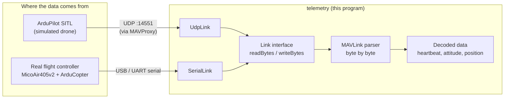
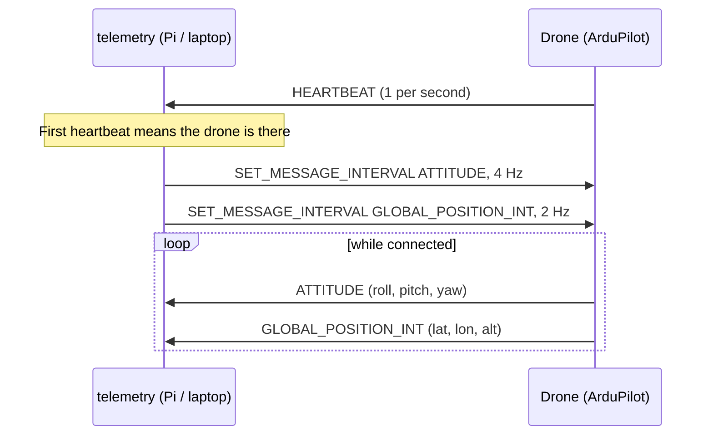

# Drone Companion

C++ companion-computer software for an ArduPilot quadcopter. It reads live flight data (MAVLink) from either the ArduPilot simulator or a real flight controller, and is built to run on a Raspberry Pi mounted on the drone.


-red)


---

## What it does today

- Connects to a drone over **UDP** (ArduPilot SITL simulator) or **serial/USB** (real flight controller)
- Parses the **MAVLink** byte stream and prints live:
  - **Heartbeat**: armed state and flight mode
  - **Attitude**: roll, pitch, yaw in degrees
  - **Position**: latitude, longitude (7 decimal places, about 1 cm) and altitude
- **Asks the flight controller** for the data it needs (`SET_MESSAGE_INTERVAL`) instead of relying on ground-station settings
- Builds a **Raspberry Pi (Linux arm64)** version of the same program from a Mac using Docker

The same code runs against the simulator and the real drone. Only the connection ("link") changes.

---

## How it works



**Two layers:**

| Layer | Files | Job |
| --- | --- | --- |
| **Link** (the "pipe") | `src/links/` | Moves raw bytes in and out. `UdpLink` for the simulator, `SerialLink` for real hardware. Both follow the same `Link` interface. |
| **Parsing** (the "understanding") | `src/main.cpp` | Feeds bytes to the MAVLink parser and turns complete messages into readable values. Never knows which link it is using. |

### Talking to the flight controller



---

## Hardware

| Part | Model | Notes |
| --- | --- | --- |
| Frame | 5-inch quadcopter | Running a 3S LiPo |
| Flight controller | MicoAir405v2 | ArduCopter 4.7.2, BMI088 IMU, SPL06 barometer |
| GPS + compass | HGLRC M100-5883 | GPS on UART (SERIAL3), compass (QMC5883P) on I2C. Both detected and healthy on the bench. Compass calibrated. GPS fix outdoors not yet confirmed |
| Companion computer | Raspberry Pi Zero 2 W | Runs this program on the drone. Connects to the FC over USB and relays MAVLink to QGroundControl over Wi-Fi via mavlink-router |
| Camera | Raspberry Pi camera module | Planned |
| Rangefinder | Garmin LIDAR-Lite v3 | Planned (downward-facing) |

---

## Project structure

```
drone-companion/
├── CMakeLists.txt          # Build instructions
├── src/
│   ├── main.cpp            # MAVLink parsing + printing
│   └── links/
│       ├── Link.h          # Interface every connection follows
│       ├── UdpLink.h       # Connection to the simulator (UDP)
│       └── SerialLink.h    # Connection to the real flight controller (serial/USB)
├── docker/
│   └── Dockerfile.pi       # Linux arm64 build environment for the Pi
├── scripts/
│   └── build-pi.sh         # One command to build the Pi version
└── external/
    └── c_library_v2/       # Official MAVLink C library (git submodule)
```

---

## Key ideas (for newcomers)

- **MAVLink**: the message format drones and ground stations use to talk. Each message has an ID (like an email subject line) and a fixed set of fields.
- **ArduPilot SITL**: "Software In The Loop". The real ArduPilot firmware running on your computer with simulated physics, so code can be tested without flying.
- **Link interface**: one shared set of methods (`openLink`, `readBytes`, `writeBytes`, `closeLink`). Swapping simulator for hardware means swapping the link, not rewriting the program.
- **Docker build for the Pi**: the Pi runs Linux on an ARM chip, so it needs its own build. A Debian container builds it on a Mac, and the output file is copied to the Pi.

---

## Getting started

### 1. Prerequisites (macOS)

- Xcode Command Line Tools, CMake, Git
- [ArduPilot](https://github.com/ArduPilot/ardupilot) with SITL built (for simulator testing)
- Docker Desktop (only for building the Raspberry Pi version)

### 2. Clone

```bash
git clone --recurse-submodules https://github.com/rizwanuddin/drone-companion.git
cd drone-companion
```

`--recurse-submodules` also downloads the MAVLink library.

### 3. Build (on your computer)

```bash
cmake -S . -B build
cmake --build build
```

### 4. Run against the simulator

Start SITL with an extra output on port 14551:

```bash
cd ~/ardupilot
Tools/autotest/sim_vehicle.py -v ArduCopter --console --map --out=127.0.0.1:14551
```

In another terminal:

```bash
./build/telemetry
```

Then in the SITL terminal: `mode guided`, `arm throttle`, `takeoff 10`, and watch the altitude climb.

### 5. Run against a real flight controller (USB)

Close any ground-station app first (only one program can use the port).

```bash
ls /dev/cu.usbmodem*                          # find the flight controller
./build/telemetry serial /dev/cu.usbmodemXXXX
```

Tilt the board and roll/pitch change live.

### 6. Build and run on the Raspberry Pi

On your Mac:

```bash
./scripts/build-pi.sh
file build-pi/telemetry    # should say: ELF 64-bit ... ARM aarch64
```

Copy it to the Pi and run it (flight controller plugged into the Pi's **USB** port, not **PWR**):

```bash
scp build-pi/telemetry <user>@<pi-hostname>.local:~/
ssh <user>@<pi-hostname>.local
chmod +x telemetry
./telemetry serial /dev/ttyACM0
```

The Pi needs a **64-bit** OS (`uname -m` should print `aarch64`).

---

## Example output

```
Connected using serial. Waiting for drone...
[HEARTBEAT] armed=no mode=0
Requested ATTITUDE and POSITION from the drone
[ATTITUDE] roll=3.2 pitch=-1.3 yaw=-13.7
[POSITION] lat=37.3351999 lon=-121.8810999 alt=-0.01m
```

---

## Roadmap

- [x] CMake project with the MAVLink library
- [x] Live telemetry from ArduPilot SITL (UDP)
- [x] Live telemetry from a real flight controller (serial/USB)
- [x] Raspberry Pi build with Docker
- [x] GPS and compass wired and detected (QMC5883P needs Copter 4.7.2)
- [x] Pi relays MAVLink to QGroundControl (mavlink-router as a systemd service)
- [x] Xbox joystick through QGC, radio and GCS failsafe bench-tested (props off)
- [ ] GPS fix outdoors, compass recalibration for a green bar, heading check
- [ ] Measure joystick latency over Wi-Fi
- [ ] Short low hover in Stabilize
- [ ] `TelemetrySample` struct to separate parsing from output
- [ ] Flight logging to CSV
- [ ] Sending commands from code (arm, takeoff, fly to a point, land)
- [ ] Multithreaded pipeline (reader thread + ring buffer)
- [ ] Unit tests and simulator-based CI (GitHub Actions)

---

## Pi link to QGroundControl (mavlink-router)

The Pi forwards MAVLink between the flight controller (USB) and QGroundControl (UDP over Wi-Fi), and exposes `udp://127.0.0.1:14540` for local apps. Configs and setup notes: [`docs/pi-setup.md`](docs/pi-setup.md), files under `pi/` and `tools/`.

## Safety

- Props **off** for all bench testing.
- Fly real hardware only within visual line of sight and local rules (FAA registration and Remote ID in the US, check airspace with B4UFLY).


